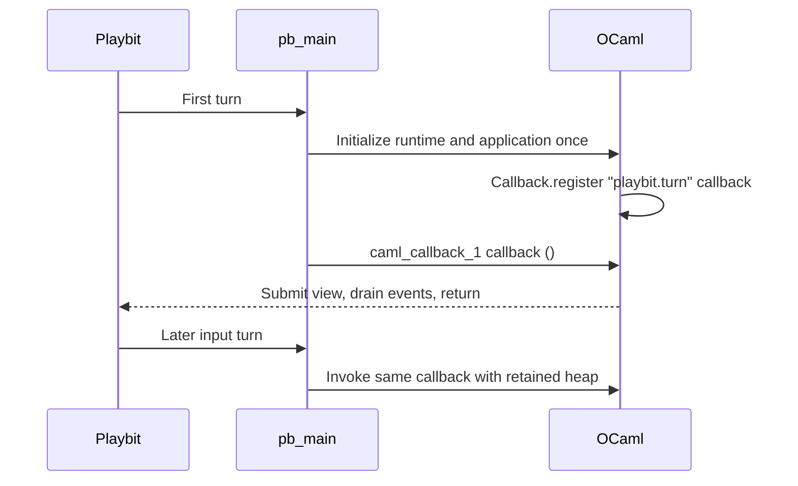

# Playbit host target

`wasm_of_ocaml --target playbit primitives.wat application.byte -o application.wasm`
compiles one linked OCaml bytecode executable into one Wasm GC module. It defaults
to CPS effects. JavaScript/WASI targets retain their existing behavior.

The module exports `memory` and `pb_main : () -> ()`, with no start section.
Its only permitted host import is `playbit.pb_syscall`, a function with parameters
`i32, i64, i64, i64, i64, i64, i64` and one `i64` result. The Playbit runtime also
validates that exact signature when linking. The compiler runtime owns no opcode
table; applications supply generated scalar calls and OCaml buffer adapters as
primitive modules at link time. The current SDK lives in Archipelago's `ocaml/`.

`playbit.wat` owns memory and entry state. `playbit_sys.wat` supplies target
constants and the fixed executable name/argument `playbit`. The ordinary IO runtime
retains valid channel objects and the output-channel registry during Stdlib
initialization. Empty-channel flushes are valid; other stdio operations remain
unsupported, and pending-output flushes raise an explicit error. Use the SDK's
explicit log call.

A reentrant or previously failed entry traps. Uncaught exceptions propagate to
the host, which halts the guest generation. The Playbit optimizer deliberately
omits `--traps-never-happen`, so failure guards remain executable. Modern
exception references, GC, typed function references and tail calls are required.
No JSPI or stack switching is used. The host bounds the aggregate GC and linear
heap; it must not allow a guest that trapped to resume.

WASI, Dynlink, separate compilation, a toplevel and source maps are currently
rejected for this target. Unsupported reachable imports are link errors rather
than ambient host access. Package replacement creates a new heap. The native
OCaml REPL experiment is independent of this Wasm target.

From Archipelago, `gmake -C ocaml wasm-test` exercises generated bindings, entry
state, exceptions, integer widths, buffers and actual Playbit backends. The
browser compatibility harness uses the production Playbit browser adapters.
